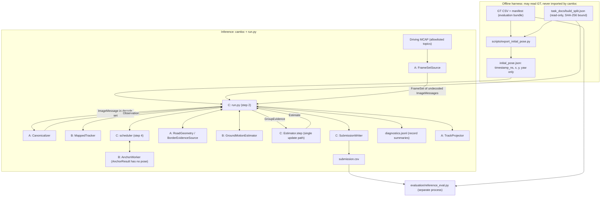
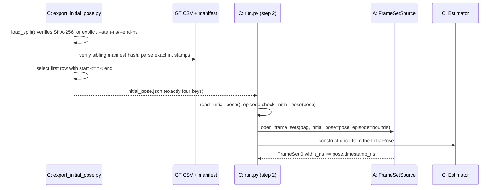
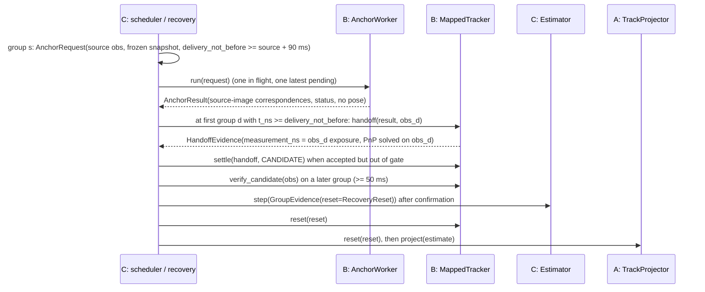

# Design Document: shared-contracts

## Overview

Teammate C's step 1 freezes the shared interface of the TrackCode Apex camera-only localizer so that teammate A (input, geometry, borders, track coordinates) and teammate B (map, vision, retrieval, ground motion) build against identical records and call boundaries. It adds four C-owned deliverables:

| File | Purpose |
|---|---|
| `camloc/contracts.py` | Conventions (module docstring), structural constants, enums, exceptions, validation helpers, frozen validated records, `InitialPose`/`EpisodeBounds` with JSON and split loaders, `typing.Protocol` call boundaries |
| `camloc/submission.py` | The single `timestamp_ns,x,y,yaw` CSV writer (used only by `run.py`, from step 2) |
| `scripts/export_initial_pose.py` | Offline harness; the only code here that reads GT, to select one initial pose; never imported by `camloc` |
| `tests/...` | Example tests, seeded randomized property tests, copyable A/B usage examples, the inference-isolation test |

The contracts encode the decisions that fail silently when owners disagree: integer nanoseconds and three distinct times (anchor source exposure, current measurement exposure, output group time), T_AB direction, xyzw quaternions, canonical RGB 960 x 464 pixels with OpenCV pixel centres, the six-state layout, opaque asset identities and accepted/rejected semantics. Structural violations raise `ContractError` at construction. Weak evidence is a valid record with `accepted=False` and a snake_case reason; presenting it for consumption raises `RejectedEvidenceError`. Records are frozen, stored arrays are read-only, and every record has a JSON-safe `summary()` so each rejected or low-trust output can be logged.

Nothing in this feature estimates a pose. Protocols only define interfaces; owners implement them in their own modules (AGENTS.md forbids stubs that return plausible poses). No package or lock changes. `task_docs/build_split.json`, `evaluation/`, organizer tools, the recording, `metadata.yaml`, `README.md`, the PDF and `private_guides/` are read-only. Changes to the build plan's section-6 table are collected under "Proposed shared-record changes for A/B agreement" and need A/B confirmation.

### Verified facts used by this design

| Fact | Check |
|---|---|
| Work happens on `dev/implementation` (tracking `origin/dev/implementation`, clean at `bf9b749`) | `git status --short --branch` |
| `build_split.json` SHA-256 `894b4179...c09222`; supplied map SHA-256 `648e8cf9...972ef` | `hashlib.sha256` of both files |
| Organizer `np.angle(np.exp(1j*a))` returns `-pi` for `-pi`, alters 4,210 of 100,000 in-range values and is not idempotent for 1,808 | Seeded NumPy check |
| `math.remainder(a, 2*pi)` with `-pi -> pi` is the identity on (-pi, pi], idempotent, and within 3.9e-14 rad (mod 2 pi) of the organizer helper for abs(a) <= 1e3 | Same check |
| Both scorers wrap yaw differences, so the +/-pi representation cannot change scores | `tools/evaluate.py` uses `np.angle(np.exp(1j*(syaw-gyaw)))` |
| `reference_eval.write_csv` writes `str(int)` and `format(v, ".17g")`; `read_csv` requires `[0-9]+` int64 stamps, finite values, strictly increasing rows | Source |
| `reference_eval` scores `full` as `[first_gt, last_gt + 1)`; `validate_submission` rejects stamps that are not camera exposures | Source |
| `manifest.json` lists `files["gt_tf.csv"]`; that CSV's header is `timestamp_ns,x,y,yaw`; organizer `tools/extract_gt.py` writes an extra `z` column | Manifest, header, source |
| `np.int64` is not an `int` instance; `bool` is | Python check |
| `tests/` and `evaluation/` lack `__init__.py`; `python -m pytest` puts the root on `sys.path`; `package = false`; evaluator tests import `reference_eval` from `evaluation/` | Tree and config |
| Ruff default rules (including E402, E7) apply to `camloc scripts tests`; `.kiro/` is not Git-ignored | `pyproject.toml`, `.gitignore` |

## Architecture



| Module | May import | Must not import or reference |
|---|---|---|
| `camloc/contracts.py` | stdlib, `numpy` | Other `camloc` modules, evaluation code, `scripts`, organizer tools, GT artifact names |
| `camloc/submission.py` | stdlib, `numpy`, `camloc.contracts` | Same as above |
| Other `camloc/*` (later steps) | Declared dependencies; A's adapter may load organizer `track_frame.py` | `evaluation`, `reference_eval`, `native_bridge`, organizer `evaluate`/`extract_gt`/`convert`, `scripts.*`, `tools.*` |
| `scripts/export_initial_pose.py` | stdlib, `camloc.contracts` (via `importlib` after adding the root to `sys.path`, keeping ruff E402 clean) | Evaluation Python modules (it reads the GT CSV and manifest as files) |
| `tests/*` | Anything, including `reference_eval` for compatibility checks | Writing outside pytest `tmp_path` |

## Sequence Diagrams

### Initialization and episode ownership



### Per-group camera-rate path (implemented by C in step 2/4; frozen here as call order)

```mermaid
sequenceDiagram
    participant A as A: source / canonicalizer / geometry / borders
    participant C as C: runner + scheduler
    participant B as B: tracker / ground motion
    participant F as C: Estimator
    A-->>C: FrameSet k (undecoded images, input_events)
    C->>F: snapshot(k.t_ns) (predicted prior, no state change)
    C->>A: canonicalize(image) for each camera in the decode set
    C->>B: observe(obs) exactly once per decoded Observation
    C->>B: track(obs, snapshot, aux) -> PoseEvidence
    C->>B: handoff(result, current same-camera obs) for deliveries due at k
    C->>B: verify_candidate(obs) while a recovery candidate is held
    alt no selected in-gate full pose
        C->>A: road_patch(x, y, yaw, branch) -> RoadPatch
        C->>B: estimate(previous obs, obs, patch) -> MotionEvidence
        C->>A: border_evidence(obs, snapshot, aux) at <= 5 Hz source time
    end
    C->>C: assemble GroupEvidence (camera selection, innovation gate, hierarchy)
    C->>F: step(GroupEvidence) -> Estimate
    C->>B: settle(handoff, adopt | candidate | discard) per HandoffEvidence
    C->>C: SubmissionWriter.write(estimate); summaries to diagnostics
```

### Anchor job, handoff and recovery reset



## Conventions

Normative. The `camloc/contracts.py` module docstring carries a shortened copy. That docstring and all of `camloc/submission.py` must not contain the GT artifact tokens checked by the isolation test; they say "the live state topic" and "evaluation GT files" instead.

| Topic | Convention |
|---|---|
| Time | Python `int` nanoseconds in `[0, 2**63 - 1]`. `np.integer` is accepted and converted to `int`. `float` (also integral, e.g. `1.0`), `bool`/`np.bool_`, `str` and other types are rejected. Decimal strings (JSON, split) go through `parse_decimal_ns`: `re.fullmatch(r"[0-9]+", s)` and then `int(s)`. `re.match("^...$")` is not used because `$` accepts a trailing newline; `int()` alone accepts signs, spaces, `_` and non-ASCII digits. |
| Exposure / arrival | `exposure_ns` is the image `header.stamp`. `arrival_ns` is the MCAP log time in replay. Group deadlines use arrival time. |
| Three times | `source_exposure_ns`: anchor job source image. `measurement_ns`: current same-camera image on which a pose is solved. `t_ns`: group time = max exposure of the group's images = CSV timestamp. Invariant: `source_exposure_ns <= every support stamp <= measurement_ns <= t_ns`. |
| Frames | W = `map`; B = `constructor0/base_link` (x forward, y left, z up); C = `constructor0/camera_<id>` optical (z forward, x right, y down). |
| Transforms | `T_AB` maps coordinates from B into A: `p_A = T_AB @ p_B`; 4 x 4 float64 rigid. `T_BC` is `/tf_static` parent base_link, child camera. Projection `P_C = inv(T_WB @ T_BC) @ P_W`. OpenCV PnP returns `T_CW`, so `T_WB = inv(T_CW) @ inv(T_BC)`. Use the closed-form rigid inverse (`R.T`, `-R.T @ t`). |
| Planar pose | `x = T_WB[0,3]`, `y = T_WB[1,3]`, `yaw = atan2(T_WB[1,0], T_WB[0,0])` (equals the organizer quaternion-yaw formula). Full pose from state and auxiliary geometry: `R = Rz(yaw) @ Ry(pitch) @ Rx(roll)`, `t = (x, y, z)`. |
| Quaternions | xyzw (scalar last); convert explicitly at wxyz library boundaries. |
| Angles | Radians. Every angle field is normalized by `wrap_angle` to (-pi, pi] at construction. |
| Canonical image | RGB `uint8` `(464, 960, 3)` (W x H = 960 x 464), C-contiguous; `valid_mask` `bool (464, 960)`, True = usable. Neither is copied; both are marked read-only. |
| Canonical K | float64 3 x 3, zero skew, zero distortion, OpenCV pixel centres. A computes `fx'=sx*fx`, `fy'=sy*fy`, `cx'=sx*(cx+0.5)-0.5`, `cy'=sy*(cy+0.5)-0.5`, `sx=960/1506`, `sy=464/728` from raw K (never P). Pixels lie in `[-0.5, 959.5] x [-0.5, 463.5]`. |
| Precision | Keypoints float32 `(N, 2)`; world geometry, calibration, state, covariances float64; identity arrays int64; float16 descriptors only inside B's caches. |
| State | `[x_m, y_m, yaw_rad, vx_mps, vy_mps, yaw_rate_radps]` in map axes; P 6 x 6 in the same order. z/roll/pitch are auxiliary geometry, not states. |
| Identity | `calibration_id`, `preprocessing_id`, `map_id`, model ids, `reference_map_id` are opaque non-empty owner-defined strings; contracts never compute them. `reference_map_id` is `SUPPLIED_MAP_SHA256`. |
| Cameras / routes | `CAMERA_IDS = ("fl", "fr", "cl", "cr", "r", "rl", "rr")`, primary `fr`, secondary `r`. `ROUTE_IDS = ("track", "pit")` = keys of organizer `track_frame.TOPICS`. |
| Reasons | Evidence: `accepted` with `reason`; accepted iff `reason == "accepted"`. Geometry: `valid` with `reason`; valid iff `reason == "valid"`. `AnchorResult`: status OK iff `reason == "ok"`. Every reason matches `^[a-z][a-z0-9_]*$` (checked with `re.fullmatch`). |

## Components and Interfaces

### camloc/contracts.py layout

1. Module docstring: conventions, owner call order, flows, A/B usage notes pointing to `tests/test_contract_examples.py`.
2. Constants, enums, exceptions.
3. Validation helpers and the `_Record` base (`__slots__ = ()`, `summary()`).
4. Records: input, geometry/state, evidence, anchor, recovery, group.
5. `InitialPose`, `EpisodeBounds`, JSON and split functions.
6. Protocols (call boundaries).

### Constants

```python
PROJECT_ROOT = Path(__file__).resolve().parents[1]
DEFAULT_SPLIT_PATH = PROJECT_ROOT / "task_docs" / "build_split.json"
CAMERA_IDS = ("fl", "fr", "cl", "cr", "r", "rl", "rr")
PRIMARY_CAMERA, SECONDARY_CAMERA = "fr", "r"
ROUTE_IDS = ("track", "pit")
MAP_FRAME, BODY_FRAME, CAMERA_FRAME_PREFIX = "map", "constructor0/base_link", "constructor0/camera_"
CANONICAL_WIDTH, CANONICAL_HEIGHT = 960, 464
STATE_FIELDS = ("x_m", "y_m", "yaw_rad", "vx_mps", "vy_mps", "yaw_rate_radps")
INT64_MAX, NS_PER_S = 2**63 - 1, 1_000_000_000
MAX_EXPOSURE_SPREAD_NS = 5_000_000     # absolute cap of A's min(5 ms, 0.2 T) tolerance
MAX_ARRIVAL_SPREAD_NS = 40_000_000     # absolute cap of A's min(40 ms, 1.2 T) deadline
MAX_PENDING_GROUPS = 4
DELIVERY_MIN_DELAY_NS = 90_000_000
MAX_KEYPOINTS = 1024                   # DISK retained keypoints per image
MAX_ACTIVE_TRACKS = 512
MAX_HANDOFF_POINTS, MAX_HANDOFF_TRANSITIONS = 256, 4
HISTORY_MAX_AGE_NS, HISTORY_MAX_FRAMES = 250_000_000, 32
MAX_REFERENCES_PER_JOB, RETRIEVAL_CANDIDATES = 2, 10
NORMAL_JOBS_PER_S, RECOVERY_JOBS_PER_S = 3, 4
GRID_CELLS = 16
RECOVERY_CONFIRM_MIN_NS = 50_000_000
BORDER_MAX_RATE_HZ = 5
ROTATION_TOL, LAST_ROW_TOL, UNIT_TOL = 1e-6, 1e-9, 1e-9
SYMMETRY_TOL = PSD_TOL = 1e-9           # relative to max(1, max |P|)
SUMMARY_MAX_ARRAY_ITEMS = 64
BUILD_SPLIT_SHA256 = "894b41790af50e2f555a34001ef00821164ebc4f2f2589eb2e24280088c09222"
SUPPLIED_MAP_SHA256 = "648e8cf954d8cd39823ca31c0b62d89c8fd76b170df999ac2e3d4327439972ef"
SPLIT_TIME_ENCODING = "decimal_string_nanoseconds_convert_to_integer"
SPLIT_INTERVAL_CONVENTION = "start_inclusive_end_exclusive"
SPLIT_GUARD_NS = 2_000_000_000
```

Tuning thresholds (inlier gates, innovation limits, noise floors, q densities, border search grids) stay in the owners' modules. The implementation writes one assignment per line where ruff style needs it.

### Enums (`enum.StrEnum`; values are the persisted strings)

| Enum | Values |
|---|---|
| `Status` | `tracking`, `degraded`, `recovering`, `lost` |
| `Branch` | `track`, `pit`, `unknown` |
| `FrameSetClosure` | `complete`, `deadline`, `capacity`, `eof` |
| `PoseSource` | `tracking` (active track set), `handoff` (current-image PnP after an anchor), `candidate` (uncommitted recovery candidate's own tracks) |
| `AnchorPurpose` | `front_anchor`, `rear_anchor`, `recovery`, `warm_retrieval` |
| `AnchorStatus` | `ok`, `failed`, `backend_fault`, `cancelled` |
| `AuxSource` | `pnp`, `road_patch`, `none` |
| `EvidenceKind` | `initial_pose`, `pnp`, `handoff_pnp`, `ground_motion`, `border`, `recovery_reset`, `prediction_only` |
| `HandoffDisposition` | `adopt`, `candidate`, `discard` |
| `InputEventKind` | `no_calibration`, `calibration_mismatch`, `before_initial_pose`, `after_episode_end`, `late_support`, `duplicate_stamp`, `decreasing_stamp`, `decode_failure`, `coverage_gap`, `end_of_input` |

`InputEvent.reference_ns` meaning per kind: previous exposure of that camera (`duplicate_stamp`, `decreasing_stamp`), closed group's time (`late_support`), initial-pose stamp (`before_initial_pose`), episode end (`after_episode_end`), previous group time (`coverage_gap`, whose `exposure_ns` is the next group's time).

### Exceptions

```python
class ContractError(ValueError):
    """Structural contract violation, raised at construction or a boundary check."""

class RejectedEvidenceError(ContractError):
    """A rejected or invalid record was presented for consumption."""

class InputError(Exception):
    """A data failure on one input, e.g. an undecodable JPEG. Recorded by C, not a contract bug."""
```

### Protocols (call boundaries; proposals for A/B agreement)

All are `typing.Protocol` classes decorated with `@runtime_checkable`; bodies are `...` with precise docstrings. They are not implementations.

```python
class FrameSetSource(Protocol):                                   # A, camloc/io.py
    def calibrations(self) -> Mapping[str, CameraCalibration]:
        """Frozen first-available calibration of all seven cameras, available before iteration."""
    def __iter__(self) -> Iterator[FrameSet]:
        """Header-only grouping in recorded arrival order; group_id 0, 1, 2, ...; strictly increasing
        t_ns. Groups only images with initial_pose.timestamp_ns <= exposure_ns < episode end; others
        become InputEvents. Never decodes JPEG, dynamic /tf or the live state topic."""
    def trailing_events(self) -> tuple[InputEvent, ...]:
        """Events after the last FrameSet (always ends with end_of_input); valid after exhaustion."""

class Canonicalizer(Protocol):                                    # A, camloc/geometry.py
    def canonicalize(self, image: ImageMessage) -> Observation:
        """One JPEG decode plus one cached raw-to-canonical remap. Raises InputError on failure."""

class RoadGeometry(Protocol):                                     # A, camloc/geometry.py
    def road_patch(self, x: float, y: float, yaw: float, branch: Branch) -> RoadPatch:
        """Deterministic local plane from paired surveyed borders; invalid patches carry a reason."""

class BorderEvidenceSource(Protocol):                             # A, camloc/borders.py
    def border_evidence(self, observation: Observation, snapshot: SearchSnapshot,
                        aux: AuxiliaryGeometry) -> BorderEvidence:
        """Lateral/yaw-only evidence on this image; at most 200 samples and 85 candidate evaluations."""

class TrackProjector(Protocol):                                   # A, camloc/track_coords.py
    def project(self, estimate: Estimate) -> tuple[TrackProjection, TrackProjection]:
        """(track, pit) projections of the estimate's own x/y/yaw; never GT or native state fields."""
    def reset(self, reset: RecoveryReset) -> None:
        """Clear sequence-projection history so the next projection searches globally."""

class MappedTracker(Protocol):                                    # B, camloc/vision.py
    def observe(self, observation: Observation) -> None:
        """Called exactly once per decoded Observation, in group order, before any other use of it.
        B keeps gray history of <= HISTORY_MAX_AGE_NS and <= HISTORY_MAX_FRAMES per camera."""
    def track(self, observation: Observation, snapshot: SearchSnapshot,
              aux: AuxiliaryGeometry) -> PoseEvidence:
        """Bounded LK on <= MAX_ACTIVE_TRACKS mapped tracks and RANSAC PnP on this image (source=tracking)."""
    def handoff(self, result: AnchorResult, current: Observation) -> HandoffEvidence:
        """Carry result's source pixels to `current` (same camera) through <= 4 chronological LK
        transitions over history, <= 256 points, and solve fresh PnP at current.exposure_ns.
        Does not modify track sets; rejected outcomes carry a reason."""
    def settle(self, handoff: HandoffEvidence, disposition: HandoffDisposition) -> None:
        """C's decision, exactly once per HandoffEvidence, after step() of that group: adopt into the
        active set, hold as the single recovery candidate (replacing any earlier one) or discard."""
    def verify_candidate(self, observation: Observation) -> PoseEvidence | None:
        """PnP on the held candidate track set (source=candidate); None when no candidate is held."""
    def reset(self, reset: RecoveryReset) -> None:
        """After confirmed recovery: promote the candidate set and drop tracks of the old hypothesis."""

class AnchorWorker(Protocol):                                     # B, camloc/vision.py / retrieval.py
    def run(self, request: AnchorRequest) -> AnchorResult:
        """Extraction, optional retrieval and <= 2 reference matches on request.observation only.
        Deterministic in (request, frozen assets); never reads estimator state, wall clock, other
        images or pending requests. Expected failures return status failed; C maps exceptions and
        watchdog expiry to backend_fault. C's scheduler alone dispatches and delivers."""

class GroundMotionEstimator(Protocol):                            # B, camloc/vision.py
    def estimate(self, previous: Observation, current: Observation, patch: RoadPatch) -> MotionEvidence:
        """Same camera, previous.exposure_ns < current.exposure_ns; invalid patch -> rejected evidence."""

class Estimator(Protocol):                                        # C, camloc/filter.py (step 2)
    def snapshot(self, t_ns: int) -> SearchSnapshot:
        """CV-predicted prior at t_ns >= last committed time; no state change."""
    def step(self, evidence: GroupEvidence) -> Estimate:
        """The single update path: predict to evidence.t_ns, apply consumed slots once, return Estimate."""
```

### Proposed owner entry points (finalized at integration; not implemented here)

| Owner | Entry point |
|---|---|
| A | `camloc.io.open_frame_sets(bag: Path, *, initial_pose: InitialPose, episode: EpisodeBounds, cameras: tuple[str, ...] = (PRIMARY_CAMERA, SECONDARY_CAMERA)) -> FrameSetSource` |
| A | `camloc.geometry.make_canonicalizer(calibrations) -> Canonicalizer`; `camloc.geometry.load_road_geometry(map_mcap: Path) -> RoadGeometry` |
| A | `camloc.borders.make_border_source(road: RoadGeometry) -> BorderEvidenceSource`; `camloc.track_coords.load_track_projector(map_mcap: Path) -> TrackProjector` |
| B | `camloc.vision.load_tracker(artifacts: Path, calibrations) -> MappedTracker`; `load_anchor_worker(artifacts: Path) -> AnchorWorker`; `make_ground_motion() -> GroundMotionEstimator` |
| C | `camloc.filter` estimator constructed from exactly one `InitialPose`; `camloc.submission.SubmissionWriter` |

### Flows between owners

1. Decode set (C decides, A executes). `fr` every group. `r` while a rear anchor job is in flight (from its source group through delivery or rejection), when `fr` is missing, or when `fr` tracking evidence is rejected in that group (decided after processing `fr`). A's grouping never decodes; header pairing of `r` keeps output timestamps identical across frontend modes.
2. Road patches. C calls `road_patch(x, y, yaw, branch)` with the snapshot pose at most once per group when plane-dependent evidence is needed, and passes that same `RoadPatch` to B's ground motion and to C's auxiliary geometry. An invalid patch disables ground motion and border updates for that group.
3. Auxiliary z/roll/pitch. Source `pnp`: extracted from the latest accepted current PnP `T_WB` (`source_ns` = its measurement exposure). Source `road_patch`: plane height plus a fitting-only body-to-road height offset (frozen artifact, A/C) and plane roll/pitch. Otherwise `none`. C carries it in `SearchSnapshot`/`Estimate`; A/B use it to compose `T_WB`. Never filled from GT.
4. Anchors. C's scheduler freezes the source `Observation` and `SearchSnapshot` in an `AnchorRequest`. The result holds source-image correspondences only. At the first group with `t_ns >= delivery_not_before_ns`, C calls `handoff(result, same-camera observation of that group)`; the measurement is the current image.
5. Recovery. C holds one candidate. Confirmation needs an accepted pose at least `RECOVERY_CONFIRM_MIN_NS` later; C then sends `RecoveryReset` through `GroupEvidence.reset`, and after `step()` calls `MappedTracker.reset` and `TrackProjector.reset`.
6. Input events. A attaches anomalies to the next `FrameSet` (or `trailing_events()`); C creates `decode_failure` events when `canonicalize` raises `InputError`.
7. Diagnostics. C writes `record.summary()` for every FrameSet, evidence record, `GroupEvidence`, `Estimate` and anchor record to JSONL, never to the CSV.

### camloc/submission.py

```python
HEADER = "timestamp_ns,x,y,yaw"

def format_row(t_ns: int, x: float, y: float, yaw: float) -> str:
    """Pure: f"{t_ns},{x:.17g},{y:.17g},{yaw:.17g}\n" after strict validation."""

class SubmissionWriter:
    def __init__(self, path: str | os.PathLike[str]) -> None: ...   # exclusive create, writes HEADER + "\n"
    def write(self, estimate: Estimate) -> None: ...               # strictly increasing t_ns, group estimates only
    def flush(self) -> None: ...
    def close(self) -> None: ...
    rows: int                                                     # read-only property
    last_t_ns: int | None                                         # read-only property
    def __enter__(self) -> "SubmissionWriter": ...
    def __exit__(self, *exc_info: object) -> None: ...
```

The file is opened with `open(path, "x", encoding="utf-8", newline="")`: no BOM, `\n` endings, refusal to overwrite (`FileExistsError`). `write` uses `estimate.t_ns` and `estimate.state[0:3]` and rejects initialization estimates (`group_id is None`), because the scorer requires camera-exposure timestamps. A failed write leaves earlier rows untouched.

### scripts/export_initial_pose.py

```text
.venv/Scripts/python.exe -B scripts/export_initial_pose.py --split tune --out tmp/c/initial_pose_tune.json
.venv/Scripts/python.exe -B scripts/export_initial_pose.py --start-ns N [--end-ns M] [--gt PATH] --out PATH
```

```python
DEFAULT_GT = ROOT / "evaluation" / "reference_reconciled" / "gt_tf.csv"
def main(argv: Sequence[str] | None = None) -> int: ...          # 0 success, 1 data/integrity error, 2 usage
def resolve_bounds(split: str | None, start: str | None, end: str | None) -> EpisodeBounds: ...
def verify_manifest(gt_path: Path) -> str | None: ...           # verified SHA-256, or None if no sibling manifest
def select_initial_pose(gt_path: Path, bounds: EpisodeBounds) -> InitialPose: ...
```

`--split` and `--start-ns` are mutually exclusive; one is required. Explicit bounds use `parse_decimal_ns`; `--end-ns` omitted means until the end of the GT file. When the GT file's directory contains `manifest.json`, its `files[<gt name>]` entry must exist and equal the file's SHA-256 (this covers the default bundle and lets tests use a synthetic manifest). The CSV must have `timestamp_ns,x,y,yaw` columns; extra columns such as organizer `z` are ignored and never exported. All stamps are parsed exactly with `parse_decimal_ns` and must be strictly increasing. The first row with `start <= t < end` becomes the one pose, written through `contracts.write_initial_pose` (exclusive create); the script prints `initial_pose timestamp_ns=<t> -> <out>`. No row in bounds, a hash mismatch, an existing `--out` or a malformed stamp exits 1 without writing. The script imports `camloc.contracts` inside a helper after inserting the root into `sys.path`.

### Tests

| File | Content |
|---|---|
| `tests/contract_factories.py` | Seeded helpers: random rotations (QR with det fix), rigid builders, valid record builders. Imported by tests only. |
| `tests/test_contracts_primitives.py` | Time, angle, rigid, covariance, reason and identity helpers; constants and enum values |
| `tests/test_contracts_records.py` | Input, geometry and state records; immutability; summaries |
| `tests/test_contracts_evidence.py` | Correspondences, pose, handoff, motion and border evidence; `require_accepted` |
| `tests/test_group_evidence.py` | Anchor records, `RecoveryReset`, `GroupEvidence` rules |
| `tests/test_initial_pose.py` | `InitialPose` JSON, `EpisodeBounds`, `load_split` |
| `tests/test_contract_examples.py` | Copyable A/B/C usage examples; Protocol conformance with test-only fakes returning rejected evidence |
| `tests/test_submission.py` | Writer format, ordering, compatibility with `reference_eval.read_csv` |
| `tests/test_initial_pose_export.py` | Exporter on synthetic GT in `tmp_path`; real bundle under `skipUnless` |
| `tests/test_inference_isolation.py` | AST and runtime import isolation of `camloc` |

## Data Models

Every record is `@dataclass(frozen=True, slots=True, kw_only=True)` deriving from `_Record`. `__post_init__` validates and normalizes through `object.__setattr__`. Records holding numpy arrays, directly or through nested records, use `eq=False` (identity equality, because dataclass equality on arrays is ambiguous); tests compare fields explicitly. Small arrays are copied to the declared dtype and made read-only; images and masks are only checked and made read-only. Sequences are stored as tuples. Common rules: camera ids in `CAMERA_IDS`; identity strings non-empty; stamps via `as_ns`; floats finite (`bool` rejected); angles wrapped.

### Input records

```python
class ImageMessage(_Record):          # eq=True; A's reader output, never decoded during grouping
    camera_id: str; exposure_ns: int; arrival_ns: int
    source_id: str                    # opaque, unique per message within a run (A-defined)
    frame_id: str                     # header.frame_id
    image_format: str                 # CompressedImage.format, e.g. "jpeg"
    calibration_id: str               # frozen calibration that applies to this camera
    data: bytes                       # non-empty JPEG payload (bytes, not bytearray/memoryview); never summarized

class InputEvent(_Record):            # eq=True
    kind: InputEventKind; log_ns: int
    camera_id: str | None = None; exposure_ns: int | None = None
    reference_ns: int | None = None; source_id: str | None = None; detail: str = ""

class CameraCalibration(_Record):     # eq=False
    camera_id: str; calibration_id: str; preprocessing_id: str; frame_id: str
    raw_width: int; raw_height: int   # positive
    K_raw: np.ndarray                 # float64 (3, 3) camera_info K: fx, fy > 0, zero skew, last row [0, 0, 1]
    D_raw: np.ndarray                 # float64 (5,) plumb_bob k1, k2, p1, p2, k3
    K: np.ndarray                     # float64 (3, 3) canonical K (same structural rules)
    T_BC: np.ndarray                  # float64 (4, 4) rigid, camera -> body

class Observation(_Record):           # eq=False; A's canonicalizer output
    camera_id: str; exposure_ns: int; arrival_ns: int; source_id: str
    image: np.ndarray                 # uint8 (464, 960, 3) RGB, C-contiguous; read-only, not copied
    valid_mask: np.ndarray            # bool (464, 960); read-only, not copied
    calibration_id: str; preprocessing_id: str
    K: np.ndarray                     # canonical K; principal point inside [-0.5, W-0.5] x [-0.5, H-0.5]
    T_BC: np.ndarray                  # rigid

class FrameSet(_Record):              # eq=True
    group_id: int                     # >= 0; the source yields 0, 1, 2, ...
    t_ns: int                         # == max(image.exposure_ns)
    selected_camera_ids: tuple[str, ...]   # non-empty, unique, e.g. ("fr", "r")
    images: tuple[ImageMessage, ...]       # non-empty, each camera at most once, ordered as selected
    missing_camera_ids: tuple[str, ...]    # == selected cameras without an image, in selected order
    closure: FrameSetClosure
    terminal_partial: bool                 # == (closure is EOF)
    input_events: tuple[InputEvent, ...]   # since the previous FrameSet, non-decreasing log_ns
```

FrameSet rules: `max - min` of image exposures `<= MAX_EXPOSURE_SPREAD_NS`; `max - min` of arrivals `<= MAX_ARRIVAL_SPREAD_NS`; `closure is COMPLETE` iff `missing_camera_ids` is empty. Cross-FrameSet guarantees (group_id +1, strictly increasing `t_ns`, no image reused) belong to `FrameSetSource` and are re-checked by C's runner.

### Geometry and state records

```python
class AuxiliaryGeometry(_Record):     # eq=True
    source: AuxSource; source_ns: int | None
    z_m: float | None; roll_rad: float | None; pitch_rad: float | None
    road_patch_id: str | None; valid: bool; reason: str
    # valid -> source != NONE, source_ns and z/roll/pitch present; ROAD_PATCH and valid -> road_patch_id present
    # source NONE -> not valid and all values None. Classmethod unavailable(reason) builds the NONE record.

class RoadPatch(_Record):             # eq=False
    patch_id: str; branch: Branch
    query_xy: np.ndarray              # float64 (2,)
    point_W: np.ndarray | None        # float64 (3,) point on the plane
    normal_W: np.ndarray | None       # float64 (3,) unit, normal_W[2] > 0
    support: int; residual_m: float | None; valid: bool; reason: str
    # valid -> point_W, normal_W, residual_m >= 0 present and branch != UNKNOWN

class SearchSnapshot(_Record):        # eq=False; frozen prior used for LK seeding and reference search
    t_ns: int
    state: np.ndarray                 # float64 (6,), yaw wrapped
    P: np.ndarray                     # float64 (6, 6) symmetric PSD
    status: Status; branch: Branch; auxiliary: AuxiliaryGeometry

class Estimate(_Record):              # eq=False; immutable output of Estimator.step
    t_ns: int
    group_id: int | None              # None only for the diagnostic initialization estimate
    state: np.ndarray; P: np.ndarray  # as in SearchSnapshot
    status: Status; branch: Branch
    evidence_kinds: tuple[EvidenceKind, ...]   # what was applied in this step (see rules)
    reason: str                       # snake_case, e.g. "accepted", "no_evidence", "innovation_gate"
    auxiliary: AuxiliaryGeometry
    max_support_exposure_ns: int | None        # max exposure of images whose evidence was applied

class TrackProjection(_Record):       # eq=True
    t_ns: int; reference_map_id: str; route_id: str   # route_id in ROUTE_IDS
    s_m: float | None; n_m: float | None; epsi_rad: float | None
    segment_index: int | None; xy_reconstruction_residual_m: float | None
    valid: bool; reason: str          # valid -> all values present, s_m >= 0, residual >= 0, index >= 0
```

Estimate rules: `evidence_kinds` is one of `(initial_pose,)`, `(pnp,)`, `(handoff_pnp,)`, `(recovery_reset,)`, `(ground_motion,)`, `(border,)`, `(ground_motion, border)`, `(prediction_only,)`; `group_id is None` iff kinds are `(initial_pose,)`; `max_support_exposure_ns is None` iff kinds are `(initial_pose,)` or `(prediction_only,)`, and otherwise `<= t_ns`.

### Evidence records

```python
class Correspondences(_Record):       # eq=False
    camera_id: str; exposure_ns: int  # the image these pixels belong to
    keypoint_ids: np.ndarray          # int64 (N,), unique, >= 0
    pixels: np.ndarray                # float32 (N, 2) canonical (u, v) inside [-0.5, 959.5] x [-0.5, 463.5]
    landmark_ids: np.ndarray          # int64 (N,), unique, >= 0
    map_id: str                       # N <= MAX_KEYPOINTS

class PoseEvidence(_Record):          # eq=False; B's geometric verdict, C applies the innovation gate
    camera_id: str; exposure_ns: int; source: PoseSource
    T_WB: np.ndarray | None           # rigid body pose; required when accepted
    inlier_count: int                 # == len(track_ids) == len(landmark_ids)
    inlier_fraction: float            # [0, 1]
    median_error_px: float | None; p90_error_px: float | None   # >= 0, median <= p90
    occupied_cells: int               # 0..GRID_CELLS
    track_ids: np.ndarray; landmark_ids: np.ndarray             # int64 (N,), each unique
    map_id: str; calibration_id: str; preprocessing_id: str
    accepted: bool; reason: str
    # accepted -> T_WB and both errors present, inlier_count >= 1, occupied_cells >= 1
    # inlier_count <= MAX_ACTIVE_TRACKS (tracking) or <= MAX_HANDOFF_POINTS (handoff, candidate)

class HandoffEvidence(_Record):       # eq=False
    job_id: int; camera_id: str
    source_exposure_ns: int; measurement_ns: int                # source < measurement
    support_ns: tuple[int, ...]       # chain exposures, strictly increasing, within [source, measurement]
    correspondences: Correspondences | None   # current pixels + original landmark ids
    pose: PoseEvidence | None         # solved on the current image
    map_id: str; preprocessing_id: str; calibration_id: str
    accepted: bool; reason: str
    transitions: int                  # property: len(support_ns) - 1 (0 when empty)
```

HandoffEvidence rules: `len(support_ns) <= MAX_HANDOFF_TRANSITIONS + 1`. If present, `correspondences` has `(camera_id, measurement_ns)` and at most `MAX_HANDOFF_POINTS` rows, and `pose` has `(camera_id, measurement_ns)`, source `handoff` and `landmark_ids` contained in the carried correspondences. Accepted requires: `support_ns[0] == source_exposure_ns`, `support_ns[-1] == measurement_ns`, `1 <= transitions <= MAX_HANDOFF_TRANSITIONS`, `measurement_ns - source_exposure_ns <= HISTORY_MAX_AGE_NS`, correspondences present, pose present and accepted, and matching map/preprocessing/calibration ids.

```python
class MotionEvidence(_Record):        # eq=False
    camera_id: str; previous_ns: int; current_ns: int           # previous < current
    T_Bprev_Bcurr: np.ndarray | None  # planar rigid; maps current-body coordinates into the previous body
    covariance: np.ndarray | None     # float64 (3, 3) symmetric positive definite over (dx_m, dy_m, dyaw_rad)
    inlier_count: int; inlier_fraction: float
    ground_residual_m: float | None; road_patch_id: str | None
    accepted: bool; reason: str
    # planar: rotation about z only (|R[2, :] - [0, 0, 1]| and |R[:, 2] - [0, 0, 1]| <= ROTATION_TOL), |t_z| <= LAST_ROW_TOL
    # accepted -> transform, covariance, ground_residual_m >= 0, road_patch_id present; inlier_count >= 1

class BorderEvidence(_Record):        # eq=False; lateral + yaw only, never along-track
    camera_id: str; exposure_ns: int; branch: Branch
    normal_xy: np.ndarray             # float64 (2,) unit: [-sin(prior_yaw), cos(prior_yaw)]
    lateral_coordinate_m: float | None   # normal_xy . [x, y] measured
    yaw_rad: float | None             # wrapped
    R: np.ndarray | None              # float64 (2, 2) symmetric positive definite (m^2, rad^2)
    support_samples: int; support_contours: int
    conditioning: float               # reciprocal condition number of the yaw-scaled 2-parameter Jacobian, [0, 1]
    accepted: bool; reason: str
    # accepted -> lateral, yaw, R present, branch in {TRACK, PIT}
```

### Anchor, recovery and group records

```python
class AnchorRequest(_Record):         # eq=False; frozen by C's scheduler at a logical group boundary
    job_id: int; purpose: AnchorPurpose; camera_id: str
    source_group_id: int; source_exposure_ns: int
    delivery_not_before_ns: int       # >= source_exposure_ns + DELIVERY_MIN_DELAY_NS
    observation: Observation          # camera, exposure and preprocessing id equal the fields above
    snapshot: SearchSnapshot          # 0 <= snapshot.t_ns - source_exposure_ns <= MAX_EXPOSURE_SPREAD_NS
    reference_ids: tuple[int, ...]    # unique, >= 0, <= MAX_REFERENCES_PER_JOB; empty -> retrieval inside the job
    map_id: str; preprocessing_id: str
    # front_anchor -> PRIMARY_CAMERA; rear_anchor -> SECONDARY_CAMERA

class AnchorResult(_Record):          # eq=False; deliberately has no pose field of any kind
    job_id: int; purpose: AnchorPurpose; camera_id: str
    source_group_id: int; source_exposure_ns: int
    status: AnchorStatus; reason: str # "ok" iff status is OK
    correspondences: Correspondences | None   # source image; required with >= 1 row iff OK
    matched_reference_ids: tuple[int, ...]    # unique, <= MAX_REFERENCES_PER_JOB
    remaining_candidate_ids: tuple[int, ...]  # unique, <= RETRIEVAL_CANDIDATES, disjoint from matched
    map_id: str; preprocessing_id: str; model_ids: tuple[str, ...]
    worker_duration_ns: int | None    # diagnostic only; never selects ranked evidence
    def check_against(self, request: AnchorRequest) -> None: ...   # job, purpose, camera, source, map, preprocessing
```

```python
class RecoveryReset(_Record):         # eq=False; emitted by C only after confirmation
    reset_id: int; group_id: int; t_ns: int
    candidate: PoseEvidence           # first accepted candidate observation
    confirmation: PoseEvidence        # accepted, confirmation.exposure_ns - candidate.exposure_ns >= RECOVERY_CONFIRM_MIN_NS
    jump_m: float                     # >= 0, distance from the pre-reset estimate
    reason: str                       # e.g. "confirmed_recovery"; confirmation.exposure_ns <= t_ns

EvidenceRecord = PoseEvidence | HandoffEvidence | MotionEvidence | BorderEvidence

class UnusedEvidence(_Record):        # eq=False
    reason: str                       # C's disposition, e.g. "innovation_gate", "superseded_by_pose", "camera_not_selected", "recovery_candidate"
    evidence: EvidenceRecord          # accepted by its producer but not consumed

class GroupEvidence(_Record):         # eq=False; the only input of Estimator.step
    frame_set: FrameSet
    pose: PoseEvidence | HandoffEvidence | None   # the one selected, in-gate full pose
    motion: MotionEvidence | None
    border: BorderEvidence | None
    reset: RecoveryReset | None
    rejected: tuple[EvidenceRecord, ...]          # producer-rejected records (accepted=False)
    unused: tuple[UnusedEvidence, ...]
    t_ns: int; group_id: int                      # properties from frame_set
    def consumed_kinds(self) -> tuple[EvidenceKind, ...]: ...
```

`consumed_kinds()`: reset -> `(recovery_reset,)`; `PoseEvidence` -> `(pnp,)`; `HandoffEvidence` -> `(handoff_pnp,)`; otherwise motion and/or border in that order; otherwise `(prediction_only,)`. The Estimate of that step may report a subset if the filter declines a slot, with a reason.

### Initial pose and episodes

```python
class InitialPose(_Record):           # eq=True; exactly four fields
    timestamp_ns: int; x: float; y: float; yaw: float   # yaw stored wrapped

class EpisodeBounds(_Record):         # eq=True
    name: str; start_ns: int          # inclusive
    end_ns: int | None                # exclusive; None = until end of input; else end_ns > start_ns
    def contains(self, t_ns: int) -> bool: ...
    def check_initial_pose(self, pose: InitialPose) -> None: ...   # start <= pose.timestamp_ns < end

def parse_initial_pose(text: str) -> InitialPose: ...
def format_initial_pose(pose: InitialPose) -> str: ...
def read_initial_pose(path: str | os.PathLike[str]) -> InitialPose: ...
def write_initial_pose(path: str | os.PathLike[str], pose: InitialPose) -> None: ...   # exclusive create
def load_split(path: str | os.PathLike[str] = DEFAULT_SPLIT_PATH) -> Mapping[str, EpisodeBounds]: ...
```

Canonical JSON: `{"timestamp_ns": "1791918859504944006", "x": 12.25, "y": -3.5, "yaw": 0.125}` plus `\n`, UTF-8 without BOM. `load_split` returns a read-only mapping (`types.MappingProxyType`) with exactly:

| Episode | start_ns (inclusive) | end_ns (exclusive) |
|---|---|---|
| `fit` | 1791918157114146050 | 1791918857504944006 |
| `tune` | 1791918859504944006 | 1791919130302537034 |
| `holdout` | 1791919132302537034 | 1791919351506836680 |
| `full` | 1791918157114146050 (first GT) | 1791919351506836680 (last GT + 1) |

Hidden or custom runs use `EpisodeBounds(name="custom", start_ns=pose.timestamp_ns, end_ns=None)` or explicit harness bounds.

## Key Functions with Formal Specifications

### as_ns(value, name) -> int
Preconditions: none. Postconditions: returns `int(value)` with `type(result) is int` and `0 <= result <= INT64_MAX` when `value` is an `int` (not `bool`) or `np.integer`; raises `ContractError` naming `name` for `bool`, `np.bool_`, any float type (including integral values), `str` and every other type, and for out-of-range values. No side effects.

### parse_decimal_ns(text, name) -> int
Preconditions: none. Postconditions: returns `int(text)` iff `type(text) is str`, `re.fullmatch(r"[0-9]+", text)` matches and the value is in int64 range; otherwise `ContractError`. Rejects `"+1"`, `"-1"`, `" 1"`, `"1\n"`, `"1_0"`, `"1.0"`, `"1e9"` and non-ASCII digits.

### wrap_angle(angle, name) -> float
Preconditions: none. Postconditions: for a finite real non-`bool` input, `r = math.remainder(float(angle), 2*math.pi)` and returns `r if r > -math.pi else math.pi`. Hence `result` is in (-pi, pi], `wrap_angle(result) == result`, and `result == angle` when `angle` is already in (-pi, pi]. Non-finite or non-real input raises `ContractError`.

### check_rigid(T, name) -> np.ndarray
Postconditions: returns a read-only float64 `(4, 4)` copy iff the input is a real array of that shape, all finite, `max|R.T @ R - I| <= ROTATION_TOL`, `|det(R) - 1| <= ROTATION_TOL` and `max|T[3] - [0, 0, 0, 1]| <= LAST_ROW_TOL`; otherwise `ContractError`. The input is not modified.

### check_covariance(P, n, name, definite=False) -> np.ndarray
Postconditions: returns a read-only float64 `(n, n)` copy iff finite, `max|P - P.T| <= SYMMETRY_TOL * s` and `min(eigvalsh((P + P.T) / 2)) >= -PSD_TOL * s` (or `> 0` when `definite`), with `s = max(1, max|P|)`; otherwise `ContractError`.

### require_accepted(record) -> record
Postconditions: returns `record` unchanged when its `accepted` (evidence) or `valid` (geometry) flag is True; raises `RejectedEvidenceError` carrying the record type and reason when False; raises `ContractError` for objects without either flag.

### summarize(record) / record.summary() -> dict
Postconditions: returns `{"record": <class name>, <field>: <value>, ...}` where ints stay exact Python ints, floats are finite floats, enums become their string values, tuples become lists, nested records become nested summaries, arrays with at most `SUMMARY_MAX_ARRAY_ITEMS` elements become `tolist()` lists, larger arrays become `{"shape": [...], "dtype": "..."}`, `Observation.image`/`valid_mask` are always shape/dtype only and `bytes` become `{"bytes": len}`. `json.dumps(result, allow_nan=False)` always succeeds. Readers must use Python `json`, which keeps integers exact.

### SubmissionWriter.write(estimate) and format_row
Preconditions: the writer is open; `estimate` is an `Estimate`. Postconditions: appends exactly `format_row(estimate.t_ns, *estimate.state[:3])` and increments `rows` iff `estimate.group_id is not None` and `estimate.t_ns > last_t_ns`; otherwise raises `ContractError` and the file content is unchanged. `format_row` raises `ContractError` for non-int stamps, non-finite values or yaw outside (-pi, pi].

### select_initial_pose(gt_path, bounds) -> InitialPose
Preconditions: `verify_manifest(gt_path)` succeeded. Postconditions: returns the `InitialPose` of the first CSV row with `bounds.contains(t)`, with exact integer `t`, exact float `x`, `y` and wrapped `yaw`; raises `ContractError` when required columns are missing, a stamp is malformed, stamps are not strictly increasing, a selected value is non-finite or no row lies in bounds. Loop invariant: all rows read so far have strictly increasing stamps, and no in-bounds row has been seen before the selected one.

## Algorithmic Pseudocode

### GroupEvidence validation

```python
def _validate_group(g: GroupEvidence) -> None:
    exposure = {im.camera_id: im.exposure_ns for im in g.frame_set.images}

    def current(camera_id: str, measured_ns: int, what: str) -> None:
        # Current-image rule; measured_ns <= g.t_ns follows because t_ns == max(exposure.values()).
        if exposure.get(camera_id) != measured_ns:
            raise ContractError(f"{what}: not measured on this group's {camera_id} image")

    def check(record: EvidenceRecord, what: str) -> None:
        match record:
            case PoseEvidence():
                current(record.camera_id, record.exposure_ns, what)
            case HandoffEvidence():
                current(record.camera_id, record.measurement_ns, what)
            case MotionEvidence():
                current(record.camera_id, record.current_ns, what)
            case BorderEvidence():
                current(record.camera_id, record.exposure_ns, what)
            case _:
                raise ContractError(f"{what}: unsupported evidence type")

    if g.pose is not None:
        require_accepted(g.pose)
        if isinstance(g.pose, PoseEvidence) and g.pose.source is not PoseSource.TRACKING:
            raise ContractError("pose slot: handoff poses enter as HandoffEvidence, candidates via reset")
        check(g.pose, "pose")
    for slot, record in (("motion", g.motion), ("border", g.border)):
        if record is not None:
            require_accepted(record)
            check(record, slot)
    if g.pose is not None and (g.motion is not None or g.border is not None):
        raise ContractError("PnP-first hierarchy: a consumed pose excludes motion and border")
    if g.reset is not None:
        if g.pose is not None or g.motion is not None or g.border is not None:
            raise ContractError("a recovery reset is the only consumed evidence of its group")
        current(g.reset.confirmation.camera_id, g.reset.confirmation.exposure_ns, "reset")
    for record in g.rejected:                          # invariant: all earlier entries are rejected and current
        if record.accepted:
            raise ContractError("rejected tuple holds an accepted record")
        check(record, "rejected")
    for item in g.unused:                              # invariant: all earlier entries are accepted and current
        if not item.evidence.accepted:
            raise ContractError("unused tuple holds a rejected record")
        check(item.evidence, "unused")
    seen = [r for r in (g.pose, g.motion, g.border) if r is not None]
    seen += list(g.rejected) + [item.evidence for item in g.unused]
    if len({id(r) for r in seen}) != len(seen):
        raise ContractError("an evidence record appears twice")
```

### InitialPose parsing

```python
def parse_initial_pose(text: str) -> InitialPose:
    def reject_constant(token: str) -> None:
        raise ContractError(f"initial pose: non-finite JSON constant {token}")

    def unique_object(pairs: list[tuple[str, object]]) -> dict[str, object]:
        keys = [k for k, _ in pairs]
        if len(keys) != len(set(keys)):
            raise ContractError("initial pose: duplicate key")
        return dict(pairs)

    try:
        doc = json.loads(text, parse_constant=reject_constant, object_pairs_hook=unique_object)
    except json.JSONDecodeError as exc:
        raise ContractError(f"initial pose: invalid JSON: {exc}") from None
    if type(doc) is not dict or set(doc) != {"timestamp_ns", "x", "y", "yaw"}:
        raise ContractError("initial pose: exactly timestamp_ns, x, y, yaw are required")
    stamp = doc["timestamp_ns"]
    if type(stamp) is str:
        t_ns = parse_decimal_ns(stamp, "timestamp_ns")
    elif type(stamp) is int:                          # a JSON integer; bool and float are rejected
        t_ns = as_ns(stamp, "timestamp_ns")
    else:
        raise ContractError("initial pose: timestamp_ns must be a JSON integer or decimal string")
    for key in ("x", "y", "yaw"):
        if type(doc[key]) not in (int, float):        # rejects bool, str, null, containers
            raise ContractError(f"initial pose: {key} must be a JSON number")
    return InitialPose(timestamp_ns=t_ns, x=doc["x"], y=doc["y"], yaw=doc["yaw"])   # finiteness, e.g. 1e400 -> inf, checked here
```

### Split loading

```python
def load_split(path=DEFAULT_SPLIT_PATH) -> Mapping[str, EpisodeBounds]:
    raw = Path(path).read_bytes()                     # read-only access; never rewritten
    if hashlib.sha256(raw).hexdigest() != BUILD_SPLIT_SHA256:
        raise ContractError("build_split.json changed; it is hash-bound and must stay byte-for-byte")
    return episodes_from_split(json.loads(raw.decode("utf-8")))

def episodes_from_split(doc: Mapping[str, object]) -> Mapping[str, EpisodeBounds]:
    # Structural checks are separate from the hash so tests can exercise them on synthetic documents.
    if doc["time_encoding"] != SPLIT_TIME_ENCODING or doc["interval_convention"] != SPLIT_INTERVAL_CONVENTION:
        raise ContractError("unexpected split encoding or interval convention")
    ns = lambda value, name: parse_decimal_ns(value, name)
    first, last = ns(doc["first_gt_timestamp_ns"], "first_gt"), ns(doc["last_gt_timestamp_ns"], "last_gt")
    guard = ns(doc["guard_duration_ns"], "guard")
    fit, tune, holdout = ((ns(doc[k]["start_ns"], k), ns(doc[k]["end_ns"], k)) for k in ("fit", "tune", "holdout"))
    if guard != SPLIT_GUARD_NS or tune[0] - fit[1] != guard or holdout[0] - tune[1] != guard:
        raise ContractError("split guards must be exactly 2 s")
    if not (first == fit[0] < fit[1] < tune[0] < tune[1] < holdout[0] < holdout[1] == last + 1):
        raise ContractError("split episodes must be ordered, disjoint and cover first GT .. last GT + 1")
    episodes = {"fit": fit, "tune": tune, "holdout": holdout, "full": (first, last + 1)}
    return MappingProxyType({k: EpisodeBounds(name=k, start_ns=a, end_ns=b) for k, (a, b) in episodes.items()})
```

The implementation uses a named helper instead of the lambda (ruff E731).

### Initial-pose export

```python
def main(argv=None) -> int:
    args = parser.parse_args(argv)                    # argparse exits 2 on usage errors
    contracts = _contracts()                          # sys.path insert of ROOT, then importlib.import_module
    try:
        bounds = resolve_bounds(args.split, args.start_ns, args.end_ns)
        if Path(args.out).exists():
            raise contracts.ContractError(f"refusing to overwrite {args.out}")
        verify_manifest(Path(args.gt))
        pose = select_initial_pose(Path(args.gt), bounds)
        bounds.check_initial_pose(pose)
        contracts.write_initial_pose(args.out, pose)  # exclusive create
    except (contracts.ContractError, OSError) as exc:
        print(f"export_initial_pose: {exc}", file=sys.stderr)
        return 1
    print(f"initial_pose timestamp_ns={pose.timestamp_ns} -> {args.out}")
    return 0
```

## Example Usage

```python
import numpy as np
from camloc import contracts as c

# A: header-only grouping output (no JPEG decode).
fr = c.ImageMessage(camera_id="fr", exposure_ns=1_791_918_859_600_000_000, arrival_ns=1_791_918_859_642_000_000,
                    source_id="fr#1", frame_id="constructor0/camera_fr", image_format="jpeg",
                    calibration_id="calib-fr-v1", data=b"\xff\xd8...")
group = c.FrameSet(group_id=0, t_ns=fr.exposure_ns, selected_camera_ids=("fr", "r"), images=(fr,),
                   missing_camera_ids=("r",), closure=c.FrameSetClosure.DEADLINE, terminal_partial=False,
                   input_events=())

# B: a rejected tracking result is still a record with a reason.
weak = c.PoseEvidence(camera_id="fr", exposure_ns=fr.exposure_ns, source=c.PoseSource.TRACKING, T_WB=None,
                      inlier_count=0, inlier_fraction=0.0, median_error_px=None, p90_error_px=None,
                      occupied_cells=0, track_ids=np.empty(0, np.int64), landmark_ids=np.empty(0, np.int64),
                      map_id="map-v1", calibration_id="calib-fr-v1", preprocessing_id="pre-v1",
                      accepted=False, reason="too_few_tracks")

# C: the single update input; weak evidence is logged, never consumed.
evidence = c.GroupEvidence(frame_set=group, pose=None, motion=None, border=None, reset=None,
                           rejected=(weak,), unused=())
assert evidence.consumed_kinds() == (c.EvidenceKind.PREDICTION_ONLY,)
c.require_accepted(weak)        # raises RejectedEvidenceError("PoseEvidence: too_few_tracks")
diagnostic_line = json.dumps(evidence.summary(), allow_nan=False)

# C: one initial pose, explicit bounds, one CSV writer.
pose = c.read_initial_pose("tmp/c/initial_pose_tune.json")
episode = c.load_split()["tune"]
episode.check_initial_pose(pose)
with SubmissionWriter("results/tune/attempt-01/submission.csv") as writer:
    writer.write(estimate)      # estimate from Estimator.step(evidence)
```

`tests/test_contract_examples.py` holds the full, executed versions of these examples (including accepted pose, anchor request/result, handoff, motion and border records) for A and B to copy.

## Correctness Properties

*A property is a characteristic or behavior that should hold true across all valid executions of a system-essentially, a formal statement about what the system should do. Properties serve as the bridge between human-readable specifications and machine-verifiable correctness guarantees.*

### Property 1: Nanosecond type discipline

For any value v, `as_ns(v)` returns an `int` equal to v exactly when v is an `int` (not `bool`) or `np.integer` in `[0, 2**63 - 1]`, and raises `ContractError` for every `bool`, `np.bool_`, float (including integral floats), `str` or out-of-range value; for any record built with `np.int64` stamps, every stored stamp has type `int`.

**Validates: Requirements 1.1, 1.2, 1.3, 1.6**

### Property 2: Strict decimal stamps

For any int64 value t, `parse_decimal_ns(str(t)) == t`, and for any mutation of `str(t)` with a sign, surrounding whitespace, trailing newline, underscore, decimal point, exponent or non-ASCII digit, `parse_decimal_ns` raises `ContractError`.

**Validates: Requirements 1.4, 1.5**

### Property 3: Canonical angle wrap

For any finite angle a, `wrap_angle(a)` lies in (-pi, pi], `wrap_angle(wrap_angle(a)) == wrap_angle(a)`, `wrap_angle(a) == a` whenever a is in (-pi, pi], every record angle field stores `wrap_angle` of its input, and for abs(a) <= 1e3 the wrapped difference from organizer `track_frame.wrap(a)` is at most 1e-12 rad.

**Validates: Requirements 2.1, 2.2, 2.4, 2.5, 7.4**

### Property 4: Rigid transform acceptance

For any random rotation R (orthonormal, det +1) and finite translation t, `check_rigid([[R, t], [0, 1]])` returns an equal read-only float64 copy, and for any perturbation that scales or shears R beyond 1e-6, reflects it, alters the last row beyond 1e-9, inserts a non-finite value or changes the shape, it raises `ContractError`.

**Validates: Requirements 3.1, 3.2, 4.4**

### Property 5: Covariance acceptance

For any real matrix A, `check_covariance(A @ A.T)` succeeds, succeeds with `definite=True` exactly when its minimum eigenvalue is positive, and for any perturbation that breaks symmetry or makes an eigenvalue negative beyond tolerance, or inserts a non-finite value, it raises `ContractError`.

**Validates: Requirements 3.3, 3.4, 3.5**

### Property 6: FrameSet invariants

For any choice of selected cameras, present images, exposures, arrivals, closure, `terminal_partial`, `t_ns`, missing ids and input-event order, `FrameSet` construction succeeds exactly when cameras are unique and ordered, `t_ns` equals the maximum exposure, missing ids are derived, `complete` matches no missing camera, `terminal_partial` matches `eof`, spreads are within 5 ms / 40 ms and event log times are non-decreasing.

**Validates: Requirements 5.1, 5.2, 5.3, 5.4, 5.5, 5.6, 5.7**

### Property 7: Acceptance flag and reason consistency

For any evidence or geometry record and any reason string, construction succeeds only when (flag True and reason is `accepted`/`valid`) or (flag False and reason is another Snake_Case_Reason), and `require_accepted(record)` returns the record when the flag is True and raises `RejectedEvidenceError` with the reason when it is False.

**Validates: Requirements 6.2, 6.3, 6.4, 6.5**

### Property 8: Unique correspondence identities

For any N <= 1024 and id arrays, `Correspondences` and `PoseEvidence` construction succeeds only when keypoint/track ids and landmark ids are each unique, non-negative and of equal length (and `inlier_count` equals that length); injecting any single duplicate always raises `ContractError`.

**Validates: Requirements 7.1, 7.2, 7.3**

### Property 9: Anchor request timing and consistency

For any source exposure s, delivery time d and snapshot time u, an otherwise valid `AnchorRequest` constructs exactly when `d >= s + 90_000_000` and `0 <= u - s <= 5_000_000`, and any mismatch between the embedded observation and the request's camera, Source_Exposure or preprocessing id raises `ContractError`.

**Validates: Requirements 8.1, 8.2**

### Property 10: Anchor result identity

For any matched and remaining reference-id tuples, `AnchorResult` constructs exactly when matched ids are unique and at most two, remaining ids are unique, at most ten and disjoint from matched; and for any single identity field changed between a request and its result, `check_against` raises `ContractError` while the unchanged pair passes.

**Validates: Requirements 8.6, 8.7**

### Property 11: Handoff time ordering

For any source s, measurement m and support stamps, `HandoffEvidence` constructs only when `s < m` and support stamps are strictly increasing within [s, m] (at most five), and an accepted record additionally needs support to start at s and end at m, 1 to 4 transitions, `m - s <= 250_000_000`, at most 256 current-image correspondences and pose landmarks contained in them.

**Validates: Requirements 9.1, 9.2, 9.3, 9.4, 9.6**

### Property 12: Motion and border geometry

For any random planar transform (rotation about z, zero z-translation) and positive definite 3 x 3 covariance, `MotionEvidence` with `previous_ns < current_ns` constructs, while any out-of-plane rotation, z-translation, singular covariance or non-increasing stamps raise `ContractError`; for any prior yaw, `BorderEvidence` accepts `normal_xy = [-sin(yaw), cos(yaw)]` and conditioning in [0, 1] and rejects non-unit normals and conditioning outside [0, 1].

**Validates: Requirements 10.1, 10.3**

### Property 13: Group hierarchy and slot discipline

For any assignment of accepted and rejected records to the pose, motion, border, reset, rejected and unused positions, `GroupEvidence` constructs exactly when consumed slots hold accepted records, a pose excludes motion and border, a reset excludes all other consumed slots, `rejected` holds only rejected records, `unused` only accepted ones and no record appears twice; for every valid combination, `consumed_kinds()` follows the slot mapping.

**Validates: Requirements 11.2, 11.3, 11.4, 11.6, 11.8**

### Property 14: Current-image causality

For any FrameSet and any evidence record placed in any `GroupEvidence` position, construction succeeds only when the record's measured exposure equals this group's image exposure for the record's camera; any evidence from a camera absent from the group, from an earlier or later image of the same camera, or stamped after `t_ns` raises `ContractError`.

**Validates: Requirements 11.5**

### Property 15: Estimate consistency

For any state, covariance, `evidence_kinds` tuple, `group_id` and support stamp, `Estimate` constructs exactly when the state is finite with yaw stored wrapped, the covariance is symmetric PSD, the kinds are an allowed combination, `group_id is None` matches `(initial_pose,)`, and `max_support_exposure_ns` is None for initial/prediction-only kinds and otherwise at most `t_ns`.

**Validates: Requirements 12.1, 12.2, 12.3**

### Property 16: Auxiliary geometry and reset rules

For any combination of auxiliary source, validity and value presence, `AuxiliaryGeometry` constructs exactly under the source/validity rules; and for any candidate and confirmation exposures and group time, `RecoveryReset` constructs exactly when both poses are accepted, the confirmation is at least 50 ms after the candidate and not after `t_ns`, and `jump_m >= 0`.

**Validates: Requirements 12.4, 12.7**

### Property 17: Immutability

For any constructed record, assigning to any field raises, writing into any stored array raises, and mutating the caller's input arrays after construction leaves every stored small array unchanged.

**Validates: Requirements 13.2, 13.3**

### Property 18: JSON-safe summaries

For any valid record of every record type, `json.dumps(record.summary(), allow_nan=False)` succeeds, integer stamps decode back to the identical integers, enum fields appear as their string values, and no image, mask, JPEG payload or array larger than 64 elements is listed.

**Validates: Requirements 13.4, 13.5**

### Property 19: Initial-pose JSON round trip

For any int64 timestamp and finite floats x, y and yaw (including `-0.0`, subnormals and extremes), `parse_initial_pose(format_initial_pose(p)) == p` with bitwise-identical floats, the formatted object has exactly four keys with a string timestamp, and the JSON-integer timestamp encoding parses to the same pose.

**Validates: Requirements 15.1, 15.2, 15.3, 15.5**

### Property 20: Initial-pose JSON rejection

For any valid initial-pose document and any single malformed mutation (float, `bool`, signed, padded or exponent timestamp; `bool` or string coordinate; NaN, Infinity or overflow; missing, extra or duplicate key; non-object top level), `parse_initial_pose` raises `ContractError`.

**Validates: Requirements 15.4**

### Property 21: Episode bounds semantics

For any start, end (or None) and stamp t, `EpisodeBounds` constructs exactly when end is None or end > start, `contains(t)` equals `start <= t and (end is None or t < end)`, and `check_initial_pose` raises exactly when `contains(pose.timestamp_ns)` is False.

**Validates: Requirements 16.1, 16.2, 16.3**

### Property 22: Submission CSV round trip

For any strictly increasing sequence of int64 timestamps with finite x, y and wrapped yaw, writing group estimates with `SubmissionWriter` and reading the file with `reference_eval.read_csv` returns identical timestamps and bitwise-identical floats, each line equals `format_row` of its estimate, and `rows`/`last_t_ns` equal the count and final timestamp.

**Validates: Requirements 17.3, 17.6, 17.7**

### Property 23: Submission ordering and rejection

For any written prefix followed by an estimate whose `t_ns` is not greater than the last row, or an initialization estimate, `write` raises `ContractError` and the file bytes equal the prefix; for any non-integer stamp, non-finite value or yaw outside (-pi, pi], `format_row` raises `ContractError`.

**Validates: Requirements 17.4, 17.5**

### Property 24: Exporter selects the first in-bounds GT row

For any synthetic GT CSV with strictly increasing integer stamps and any bounds containing at least one stamp, the exported JSON equals the `InitialPose` of the first row with `start <= t < end`, has exactly four keys and omits every extra GT column.

**Validates: Requirements 18.4, 18.5, 18.7**

## Error Handling

| Scenario | Condition | Response | Recovery |
|---|---|---|---|
| Structural violation | Wrong type/dtype/shape, float or bool ns, non-finite value, non-rigid transform, non-PSD covariance, unknown camera, duplicate ids, stamps out of order, counts out of bounds | `ContractError` (a `ValueError`) at construction, naming the field | Producer bug; tests fail, the runner counts it as an exception rather than emitting the record |
| Weak or failed evidence | Producer gates fail | Valid record with `accepted=False` and a snake_case reason | Logged via `GroupEvidence.rejected` and `summary()`; the filter predicts |
| Consuming rejected evidence | Rejected record placed in a consumption slot or passed to `require_accepted` | `RejectedEvidenceError` | Caller bug; never silently consumed |
| Stale or non-current evidence | Evidence exposure differs from the group's image of that camera, or is later than `t_ns` | `ContractError` in `GroupEvidence` | Old anchor results must be re-solved by handoff or rejected |
| Decode failure | Canonicalizer cannot decode an image | `InputError` | C records an `InputEvent(decode_failure)`; the group still emits an estimate |
| Split changed | `build_split.json` hash or structure differs | `ContractError` | Restore the file from Git; never edit it |
| Malformed initial pose | Float/bool/signed ns, NaN/Infinity, extra/missing/duplicate keys | `ContractError` | Regenerate with the exporter |
| Pose outside episode | `pose.timestamp_ns` not in `[start, end)` | `ContractError` from `check_initial_pose` | Fix harness bounds |
| Existing output | CSV or initial-pose path exists | `FileExistsError` / exporter exit 1 | Use a fresh `results/<episode>/<attempt>/` or `tmp/c/` path |
| Out-of-order CSV row | `t_ns <= last_t_ns` or initialization estimate | `ContractError`; earlier rows unchanged | Runner bug; source guarantees increasing `t_ns` |
| GT integrity | Sibling manifest hash mismatch, malformed or non-increasing GT stamps | Exporter exit 1, no file written | Rebuild the evaluation bundle into a fresh directory if deliberately required |
| Forbidden import | `camloc` module imports evaluation/scripts/organizer scorer code | Isolation test fails | Move the code to evaluation or harness tools |

## Testing Strategy

### Unit testing approach
Example tests cover each record's accepted path, each named rejection (one `pytest.raises(ContractError)` per rule with a `match=` on the field name), enum values, constants equal to build-plan values, the organizer wrap boundary (`-pi` stays representable as `pi`), JSON edge cases (`"123\n"`, `"+1"`, `"1_0"`, `1.0`, `true`, `NaN`, `1e400`, duplicate keys) and writer details (header, `\n`, no BOM, exclusive create). Example tests in `tests/test_contract_examples.py` double as the copyable A/B usage examples.

### Property-based testing approach
`hypothesis` is not installed and no dependency is added, so properties are seeded loops: `rng = np.random.default_rng(<fixed seed>)` with at least 100 iterations per property, failing with the iteration index and inputs. Each property test carries the tag comment `# Feature: shared-contracts, Property N: <text>`. Generators include boundary values: 0 and `INT64_MAX` stamps, 19-digit stamps, `-0.0`, `5e-324`, `1.7976931348623157e308`, yaw `pi` and `nextafter(-pi, 0)`, rotations near identity and near pi, and empty id arrays.

### Integration testing approach
`tests/test_submission.py` reads written files with `evaluation/reference_eval.read_csv`, imported through a helper that adds `evaluation/` to `sys.path` inside the test (ruff E402 clean). `tests/test_initial_pose_export.py` runs the exporter on synthetic GT in `tmp_path` and, under `unittest.skipUnless((ROOT / "evaluation/reference_reconciled/manifest.json").exists(), ...)`, on the real bundle with the expected pose computed from the CSV. `tests/test_inference_isolation.py` AST-scans every `camloc/**/*.py` and runs a subprocess import of `camloc.contracts` and `camloc.submission`, comparing new `sys.modules` entries against a bare-interpreter baseline. The existing 22 tests must keep passing; all commands use `.venv/Scripts/python.exe -B -m pytest` and `.venv/Scripts/ruff.exe check camloc scripts tests` from the project root.

## Performance Considerations

Validation runs on the camera-rate path, so it uses only small-array work: shape/dtype/flag checks for images and masks (no per-pixel scans and no copy), `np.unique` on at most 1,024 ids, one `eigvalsh` on at most 6 x 6, and closed-form 4 x 4 rigid checks. A record costs microseconds to tens of microseconds; no timing claim is made until step 5 profiling. Summaries list only arrays up to 64 elements to bound diagnostics volume.

## Security Considerations

- GT isolation: `camloc` never imports evaluation code, scripts or organizer scorers; contracts/submission never mention GT artifacts. Only the offline exporter reads GT, and it exposes timestamp/x/y/yaw once.
- Input hardening: strict decimal parsing, `parse_constant` for NaN/Infinity, finiteness checks after parsing, duplicate-key rejection, exact key sets, top-level object required.
- File safety: exclusive creation for CSV and JSON outputs; the split file is opened read-only and hash-verified; tests write only under `tmp_path`.
- No network access, subprocess shells or data upload. No credentials are involved.

## Dependencies

Python 3.12.13 stdlib (`dataclasses`, `enum.StrEnum`, `typing.Protocol`, `json`, `re`, `math`, `hashlib`, `csv`, `argparse`, `types`, `pathlib`; `ast`/`subprocess` in tests), `numpy==2.3.5` and `pytest==8.4.2` from the existing lock. `hypothesis` is not used. No change to `pyproject.toml`, `uv.lock` or `requirements.txt`.

## Proposed shared-record changes for A/B agreement

AGENTS.md requires explicit proposals for shared-record changes. Relative to the build plan's section-6 table:

1. `FrameSet` holds `images: tuple[ImageMessage, ...]` (header identity plus undecoded JPEG bytes) instead of decoded observations, and adds `group_id`, `selected_camera_ids`, `closure` and `input_events`. A's grouping never decodes; C asks A's canonicalizer to decode only the decode set. `t_ns` is the max image exposure; at least one image; each camera at most once; `terminal_partial` iff `closure is EOF`; `complete` iff nothing is missing.
2. `Observation` adds `preprocessing_id`.
3. `PoseEvidence` adds `source`, `landmark_ids` (next to `track_ids`), `map_id`, `calibration_id`, `preprocessing_id`; error statistics may be `None` when no solve happened.
4. `HandoffEvidence` carries current-image `Correspondences` (current pixels plus original landmark ids) and optionally the `PoseEvidence` solved from them, with `pose.exposure_ns == measurement_ns`.
5. `MotionEvidence` adds `camera_id`, `inlier_fraction`, `road_patch_id` and a 3 x 3 covariance over planar `(dx, dy, dyaw)` in the previous-body tangent plane. `T_Bprev_Bcurr` maps current-body coordinates into the previous body and must be planar.
6. `BorderEvidence`: `t_ns` is renamed `exposure_ns` (it is an image exposure, not a group time), and `camera_id`, `support_contours` and `conditioning` (reciprocal condition number in [0, 1], JSON-safe) are added.
7. `AnchorRequest` embeds the source `Observation`, a `SearchSnapshot`, `reference_ids` (empty = retrieval inside the job), `purpose` and map/preprocessing ids, with `delivery_not_before_ns >= source_exposure_ns + 90 ms`.
8. `AnchorResult` has no pose field of any kind; it carries unique `Correspondences`, matched/remaining candidate ids, model ids, diagnostic `worker_duration_ns` and status/reason.
9. `Estimate` adds `group_id`, `evidence_kinds` and `reason`; `auxiliary` replaces "auxiliary_geometry/source/time".
10. New records: `ImageMessage`, `CameraCalibration`, `InputEvent`, `SearchSnapshot`, `Correspondences`, `RoadPatch`, `AuxiliaryGeometry`, `RecoveryReset`, `UnusedEvidence`, `GroupEvidence`, `InitialPose`, `EpisodeBounds`.

Refinements of the review decisions, each from a concrete conflict or gap against the build plan:

- Angle convention conflict. The review asked for (-pi, pi] "the same as `track_frame.wrap`". The organizer helper actually returns `-pi` for `-pi` (closed range) and is not exactly idempotent. `wrap_angle` therefore uses `math.remainder` with `-pi -> pi`; it agrees with the helper modulo 2 pi, and scores are unaffected because both scorers wrap yaw differences.
- `GroupEvidence` adds `reset` (so a confirmed `RecoveryReset` changes state through the single update path), `unused` (accepted evidence that C does not consume, such as diagnostic borders while PnP exists (plan section 4), the unselected camera pose (section 3) or an out-of-gate pose that becomes a recovery candidate (section 3)), and lets the pose slot hold `HandoffEvidence` so source/support stamps stay attached to the consumed pose.
- The innovation gate stays C's decision but is applied while C assembles `GroupEvidence`, so an out-of-gate pose does not suppress the motion/border fallback for that group.
- `Estimator.snapshot(t_ns)` returns the predicted prior at the group time instead of the last posterior; at 40 m/s a 100 ms-old snapshot is about 4 m off for LK seeding.
- `MappedTracker` adds `settle(handoff, disposition)` and `verify_candidate(observation)`. Plan sections 3a and 5 require one uncommitted candidate with its own track set, verified on a later image without another GPU job; `observe/track/handoff/reset` alone cannot express C's adopt/hold/discard decision or return candidate verification evidence. `PoseSource` gains `candidate`, `EvidenceKind` gains `recovery_reset`, and `HandoffDisposition` is new.
- Added structural constants `MAX_EXPOSURE_SPREAD_NS`, `MAX_ARRIVAL_SPREAD_NS` (absolute caps of A's adaptive tolerance and deadline), `MAX_KEYPOINTS` and `INT64_MAX`.
- The exporter verifies any sibling `manifest.json`, which includes the default bundle and makes the integrity check testable with a synthetic manifest.
- `Estimate.group_id is None` marks the diagnostic initialization estimate; the writer rejects it because the scorer only accepts camera-exposure timestamps.

## Open questions requiring A/B agreement

1. A: confirm undecoded `FrameSet`, the decode-set policy and that `FrameSetSource` guarantees strictly increasing `t_ns`; which `InputEventKind` A uses for an image that would break that ordering.
2. A: confirm `ImageMessage.source_id` format, `frame_id` validation against calibration, and `CameraCalibration` (plumb_bob `D_raw` of length 5).
3. A: confirm `BorderEvidence.conditioning` as a reciprocal condition number, `support_contours`, and branch values.
4. A/C: owner and artifact for the fitting-only body-to-road height offset used for `road_patch` auxiliary geometry.
5. B: confirm the planar `MotionEvidence` transform and its covariance parameterization.
6. B: confirm `settle`/`verify_candidate` and the candidate track-set semantics, or propose an equivalent.
7. B: confirm integer reference keyframe ids and `MAX_KEYPOINTS = 1024` correspondence rows per anchor result.
8. A/B: confirm the proposed factory entry-point names and arguments.
9. All: confirm the 64-element summary threshold for diagnostics and the reason-code vocabulary each owner will use.
