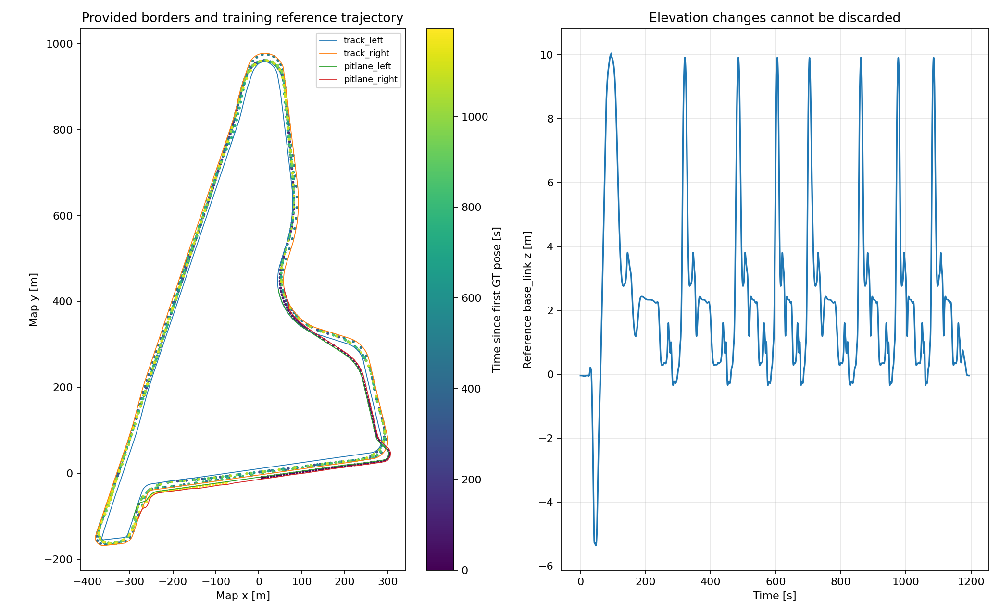
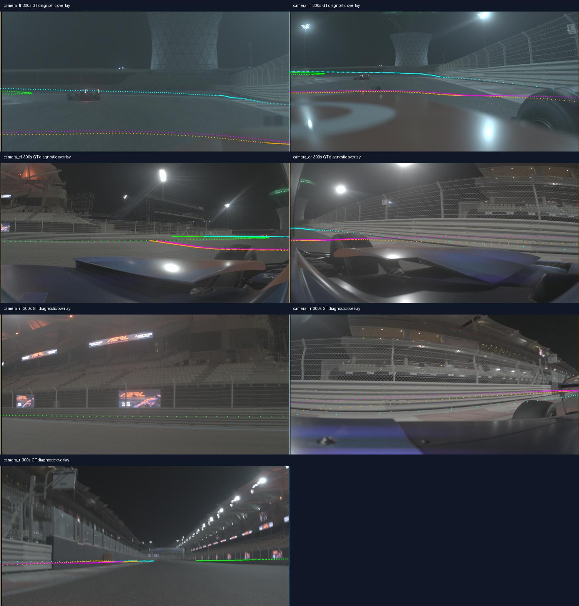

# Dataset audit for TrackCode Apex v2

Inspection date: 17 October 2026. This report records data observations and design implications. It contains no localization benchmark result.

Organizer update: `ORGANIZER_UPDATE_REVIEW.md` records the additional static map and track-coordinate tooling. All four new physical border marker arrays match this recording exactly. Native track-coordinate indices from this recording do not reconstruct its poses against the new reference Paths; do not treat the two coordinate versions as interchangeable. The original recording/split and the observations below remain applicable.

Follow-up reconciliation: the recording has 2,929 internally consistent native segment frames per route, versus 2,960 poses in the supplied Paths. The active `../../evaluation/native_bridge.py` recovers the original frames from fitting data only and uses the raw idx/ds/n fields to reconstruct positions before converting through the supplied map. Both the original coordinates and the new map are used. Independent position reconstruction and direct supplied-map conversion agree to about 0.000000000001 m. See `../../evaluation/reference_reconciled/reconciliation.json`; `../evidence/reference_coordinate_resolution.json` retains the earlier diagnostic history. The reconciled references, original raw cache and evaluation environment are intentionally retained for building.

**Materials inspected**

- All five pages of the Constructor Labs challenge PDF, including the scoring rubric, deliverables, split definition, and dataset license.
- The complete TrackCode Apex research manuscript, its two tables, three diagrams, and seven equation images. Its explicit status is proposed and unvalidated.
- The complete dataset README and metadata, and both supplied Python tools.
- MCAP summary and all 345,462 messages, including all 83,603 JPEG payloads, all 126,680 map-to-body transforms, every repeated calibration/map snapshot, and the embedded state-estimation schema.
- All JPEGs were decoded in the second review; 42 samples across six seven-camera sets were also visually reviewed. Known-pose projections were generated for three sampled times; the 300 s projection sheet was visually checked. These overlays use training reference poses and are diagnostic only.

The organizer inputs were preserved. Project cleanup retained the small audit summaries in `../evidence/` and the two useful geometry diagnostics in `../figures/`; temporary extractions, exported reference poses, package caches and superseded research drafts were removed. No dataset content was sent to a third-party semantic API. Public documentation was consulted for candidate implementation libraries.

**Verified recording facts**

| Quantity | Observed |
|---|---|
| Raw MCAP size | 7,534,435,358 bytes, approximately 7.02 GiB |
| Recording-time duration | 1,194.397986081 s |
| Messages | 345,462 |
| Channels / schemas / chunks | 18 / 5 / 905 |
| Images | 83,603 total |
| Dimensions of all 83,603 decoded images | 1506 x 728, RGB; no decode failures |
| Stored chunk / summary CRCs | All 905 chunk CRCs and the summary CRC passed; data-section CRC absent |
| Internal MCAP compression | zstd in all 905 chunks |
| Repeated calibration / static transforms / border map | One content version per topic, ignoring repeated timestamps |
| Dynamic map-to-body reference transforms | 126,680 |
| Reference timestamp duplicates / gaps above 50 ms | 0 / 0 |
| Camera timestamp non-increasing events | 0 for all seven streams |
| Camera median intervals | Approximately 100 ms |
| Reference trajectory length | Approximately 23.83 km, summing successive XY displacements |
| Locally detected GPU | NVIDIA GeForce RTX 4060 Laptop GPU, 8,188 MiB |

Hardware detection does not establish final deployment hardware, GPU availability under load, or measured inference speed.

**Missing frames and timing**

| Camera | Images | Intervals above 150 ms | Largest interval |
|---|---:|---:|---:|
| fl | 11,944 | 0 | 100.047 ms |
| fr | 11,944 | 0 | 100.050 ms |
| cl | 11,944 | 0 | 100.033 ms |
| cr | 11,944 | 0 | 100.049 ms |
| rl | 11,944 | 0 | 100.049 ms |
| rr | 11,944 | 0 | 100.050 ms |
| r | 11,939 | 5 | 204.221 ms |

The rear stream has five fewer observations than each other stream. An implementation that pairs camera images by array index becomes incorrect after the first missing rear frame. Match exposure stamps instead.

Nearest-exposure grouping relative to `fr` gives a median full-set spread of approximately 0.0216 ms and a p95 of 0.0268 ms. Twelve groups exceed 1 ms; the largest approximate spread is 100.02 ms because nearest matching substitutes another period when the rear frame is absent. These are diagnostics, not a recommended causal grouping algorithm. Detect and exclude unmatched/stale views.

Median MCAP-log-time minus exposure-time delay ranges from 41.21 to 42.58 ms across cameras; p95 ranges from approximately 48.06 to 49.27 ms. At 40 m/s, 42 ms represents about 1.68 m of travel. This is a calculated timing consequence, not a measured localization error. Correct exposure stamps matter far more here than ordinary microsecond differences between synchronized cameras.

The full second scan separates publication from recording: pooled median exposure-to-publication delay is 41.895 ms (p95 48.392 ms), and publication-to-log delay is 0.120 ms (p95 0.305 ms). The approximately 42 ms offset is mainly before publication, not disk writing. Do not shift exposure timestamps by the average delay.

A second subtlety: selecting the latest image whose stamp is less than or equal to `fr`'s stamp can accidentally select the previous cycle for a camera exposed only microseconds later. Construct a bounded same-cycle set and stamp the resulting pose at the latest exposure actually used, while preserving per-camera times. Do not include a later image in a pose stamped at the earlier `fr` time.

The first `fr` image has stamp `1791918157076983833`; the first GT body pose has stamp `1791918157114146050`. The former is approximately 37.16 ms earlier. Initialization must respect that difference.

**The map is not flat**

The four marker arrays are LINE_STRIPs in `map`, with identity marker poses in the inspected snapshot.

| Border | Points | Minimum z | Maximum z | Approximate polyline length |
|---|---:|---:|---:|---:|
| track_left | 5,914 | -0.420 m | 10.120 m | 2,958.2 m |
| track_right | 6,115 | -0.103 m | 9.902 m | 3,057.4 m |
| pitlane_left | 2,260 | -5.376 m | 10.168 m | 1,129.7 m |
| pitlane_right | 2,243 | -5.374 m | 9.952 m | 1,121.2 m |

Most consecutive samples are approximately 0.5 m apart; the largest observed step is below 1 m. Different left/right point counts mean equal array indices are not known cross-road correspondences. Preserve branch identity and longitudinal ordering when estimating local road shape.

Both main-track border polylines close exactly. Pit-lane borders are open, with endpoint separations of approximately 632.2 m and 634.7 m. Do not close them automatically or treat pit and track as a single circular route.

The reference body's z ranges from -5.357 to 10.041 m. Roll ranges approximately -2.07 to +1.61 degrees and pitch -2.47 to +2.04 degrees under the reported quaternion convention. These observations support preserving elevation and accounting for attitude in the projection model. They do not certify that border elevations uniquely determine the entire road surface or the suspension state.

The trajectory above is ground truth for inspecting the data, not an estimated trajectory.

**What the images show**

Samples near 0, 120, 300, 600, 900, and 1150 seconds show night driving with strong lights/reflections, substantial bodywork in several views, moving race cars ahead, repetitive fence/barrier structure, distinctive buildings/signage in some sectors, and pit-lane structures at the beginning. These observations support static bodywork masks, geometric outlier rejection, selective camera use, and complementary border/landmark evidence. They do not establish matching accuracy or daytime invariance.

The optical forward-axis headings computed from the supplied transforms are approximately +4.77 degrees for fl, -5.87 for fr, +65.75 for cl, -56.23 for cr, +119.09 for rl, -117.53 for rr, and -178.13 for r relative to the body x direction. The camera names alone do not imply a standard rectified stereo rig.

Calibration confidence is explicitly unequal in the README: pitch is described as reliable, yaw as reliable for r/rl, front yaw as about plus or minus one degree, cl/cr as older calibration, and roll/translation as mounting values. This report does not independently validate those accuracy estimates.

K and the left 3 x 3 block of P differ for all cameras: for `fr`, fx is 1349.904 in K versus 1174.755 in P. Under the [official CameraInfo convention](https://raw.githubusercontent.com/ros2/common_interfaces/rolling/sensor_msgs/msg/CameraInfo.msg), K/D describe raw distorted pixels and P describes rectified pixels. Use the README's K/D path initially and verify image provenance with overlays. Identity R does not imply zero lens distortion. Mixing P with original D can introduce a large systematic projection error.

Green/cyan represent projected main-track borders and orange/magenta pit borders. All nearby geometrically projectable samples were drawn, including points obscured by the vehicle or other geometry. The image demonstrates why a production matcher needs visibility/branch masks; it is not a successful border detection or an estimated pose.

**Speed and split diagnostics**

A half-second finite-difference XY speed estimate from reference poses has median approximately 18.68 m/s, p95 35.36 m/s, and maximum 40.49 m/s. Direct differences at the much higher GT rate yield a maximum near 44.91 m/s, which is more sensitive to reference noise. Do not interpret the raw maximum as an independently measured true peak speed. The README's approximately 40 m/s description is consistent with the half-second diagnostic.

Repeated position-and-heading passages suggest several usable episodes. Directed gate crossings are retained in `../evidence/lap_gate.json`; `../build_split.json` fixes the fitting/tuning/holdout boundaries used by `../FINAL_BUILD_PLAN.md`. These were selected for temporal separation, not based on algorithm scores, and are not official lap labels. The recording contains only one night session; its later laps do not validate a change of weather, rig, date, or daylight.

**Rule and evaluation risks confirmed by source inspection**

- The PDF and README disagree about whether car-state velocity/acceleration may be used. The revised design excludes the whole state-estimation topic.
- The PDF gives a weighted multi-metric ranking, whereas the README emphasizes position RMSE. Preserve all official metrics and clarify aggregation with organizers.
- The official scorer interpolates GT position and unwrapped yaw, excludes samples without a valid bracketing pair or with a GT gap over 50 ms, and computes one-second coverage over its provided GT interval.
- The scorer does not enforce camera-only causality, training/reference-map provenance, or every aspect of submission validity. Separate checks are needed.
- Empty/very short or non-finite input is not comprehensively guarded by the small starter scorer. Validate outputs separately; keep the organizer script unchanged.
- A known-pose projection visualization is useful for calibration diagnosis but cannot be submitted as independent localization evidence.
- Dataset redistribution and commercial reuse require permission under the supplied brief. Keep raw imagery and MCAP out of a public code archive.

The state topic also contains nested track/pit progress, lateral offsets and heading errors. Removing only XYZ/yaw would still leave location information. Keep the entire topic outside inference. The brief does not explicitly decide whether a GT-anchored frozen landmark bank may be carried into inference; the system design now makes that extension conditional on organizer clarification.

**Reference-pose and quality-field cross-check**

There are 126,574 state messages and 126,680 dynamic TF poses. At the 126,568 exactly shared timestamps, XYZ agrees exactly and yaw agrees within floating-point precision. Six state timestamps lack an exact TF match; do not join these streams by row index or count them as independent sources of ground truth.

In 1,228 state messages between approximately 43.239 and 54.821 s, at least one component of the undocumented `pos_accuracy` field exceeds the diagnostic threshold 10. Across the run its component maxima are about 148.25, 323.80 and 444.34. The schema does not define units or statistical meaning. This is a producer clarification item, not a measured pose-error result. Do not interpret the field as metres or covariance, feed it into inference, or remove official scored samples based on it. The advertised roughly 0.1 m reference accuracy should not be treated as a uniform per-sample guarantee.

**Reproduction and checks performed**

The completed audits read the bag without modifying it. The full scan traversed every message, compared fast exposure extraction with the ROS decoder for every image, fully decoded every JPEG, compared all repeated calibration/static/map payloads, and validated stored chunk CRCs. A separate footer calculation confirmed the summary CRC. Results are retained in `../evidence/dataset_recheck.json`; the data-section CRC is zero/absent. Counts agree with metadata. The original GT exporter produced 126,680 rows. Map shapes, calibration dimensions and quaternion normalization were checked. Temporary audit scripts and GT exports were removed after consolidation; use the preserved organizer extractor to regenerate GT when building.

Eight synthetic cases exercised the unchanged official scorer, including duplicate/non-finite rows, 1 Hz coverage, ordering, no overlap, and direct map-frame translation error. Results are in `../evidence/scorer_behavior.json`; these are scorer checks, not algorithm benchmarks. The reference-quality-field diagnostic is retained in `../evidence/reference_field_diagnostic.json`. The consolidated interpretations and outstanding organizer questions are in `Requirements_and_Risk_Review.md`.

The removed audit package cache used mcap 1.5.0, mcap-ros2-support 0.5.7, lz4 4.4.5, and zstandard 0.25.0. That cache was not the final pinned inference environment. Install and pin the working build environment as specified by the final plan.

**Not checked or established**

No localization algorithm was trained, implemented, or benchmarked. No inference latency, real-time capability, calibrated confidence, recovery rate, cross-lighting performance, or hidden-test accuracy was established. All JPEGs decoded and all available chunk/summary CRCs passed, but these checks do not certify calibration accuracy, reference-pose accuracy, or visual usefulness. The 42-image visual inspection is a sample, not a full visual quality census. The linked INTRO PDF remains unread because it is absent locally and the link could not be retrieved.
